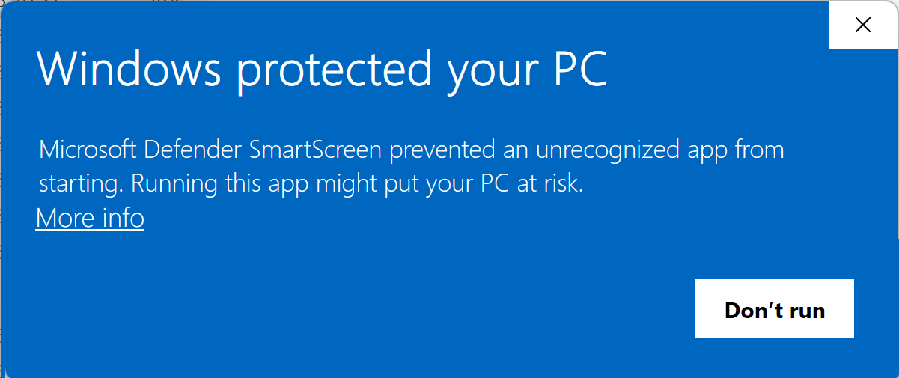
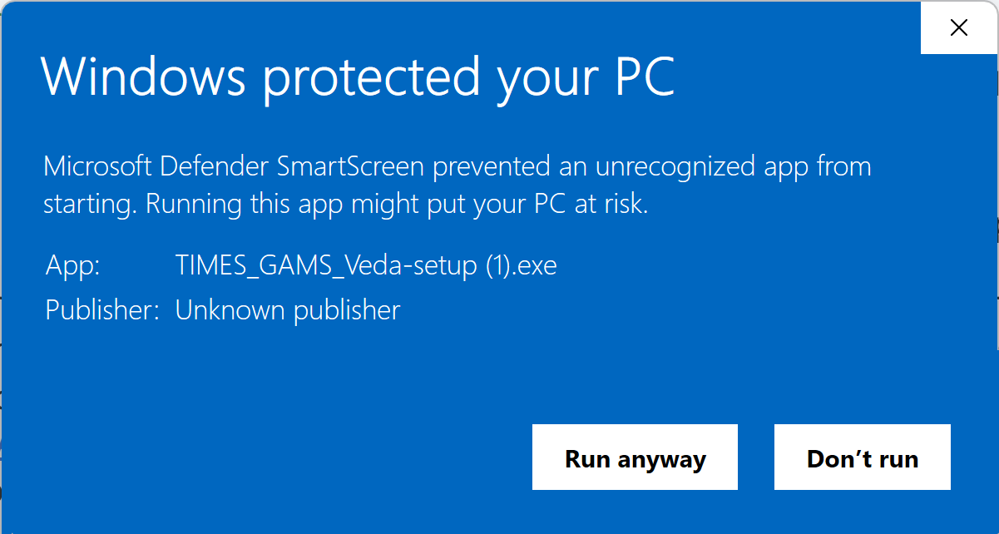

# TIMES/GAMS/Veda installer

This repository builds and provides the Windows installer for **TIMES/GAMS/Veda** (`TIMES_GAMS_Veda-setup.exe`), which bundles:

- [**GAMS**](https://www.gams.com) with the solvers CBC, CONOPT, COPT, CPLEX, Gurobi, HiGHS, Ipopt, IPOPTH, MINOS, MOSEK, SCIP, SoPlex and Xpress,
- [**Veda 2.0**](https://github.com/kanors-emr/Veda2.0-Installation), the localhost edition,
- a standalone **Python** (downloaded with [uv](https://docs.astral.sh/uv/)) with the [**GAMSPy**](https://github.com/GAMS-dev/gamspy) package.

This installer has been designed to ease the onboarding process of the ETSAP TIMES model. It includes all parts to run the [demonstration and starter models](https://iea-etsap.org/demonstration-and-starter-models/). As part of the installation, the user needs to enter the Access Code of a GAMS license. A free personal GAMS license can be created in a few minutes from the [GAMS portal](https://portal.gams.com/). For anything beyond a free personal license, complete the request from the ETSAP web page [Getting started with TIMES modelling](https://iea-etsap.org/getting-started-withtimes-modelling/).

## Installation

This [video](https://github.com/ClemensGAMS/times-gams-veda-installer/blob/main/video.mp4) shows the entire installation process.

Download the installer from the [latest release](https://github.com/ClemensGAMS/times-gams-veda-installer/releases/latest/download/TIMES_GAMS_Veda-setup.exe).

The installer has not been signed, so Windows might warn you with the following pop-up.



You can check the SHA256 checksum to make sure that the installer is genuine. The [release page](https://github.com/ClemensGAMS/times-gams-veda-installer/releases) shows it next to `TIMES_GAMS_Veda-setup.exe` as `sha256:` followed by the checksum. Open a command prompt, navigate to the Downloads folder and run the following command. Compare the printed checksum with the one on the GitHub release page.

```
certutil -hashfile TIMES_GAMS_Veda-setup.exe SHA256
```

If the two checksums match, click **More info** and then **Run anyway**:



If you need to update the GAMS license, have the Access Code of the license ready, open a command prompt and run the following command, replacing `<access-code>` with your own Access Code:

```
"%TIMES_GAMS_VEDA_GAMSDIR%\gamsgetkey" <access-code> -o "%TIMES_GAMS_VEDA_GAMSDIR%\gamslice.txt"
```

If you need to install additional solvers, e.g. cuOpt, open a command prompt and run the following command:

```
"%TIMES_GAMS_VEDA_GAMSDIR%\..\..\..\python.exe" -m gamspy_cli install solver cuopt
```

Good to know: the installer does not need administrator rights. Installing a new version replaces the one already installed, so only one version is installed at a time. If GAMS is already installed on your computer and is on the system `PATH`, Veda might use that installation instead of the bundled one.

After the installation, start Veda with the Veda2.0 shortcut on your desktop. To uninstall, use **Installed apps** in the Windows Settings, as for any other program.

## Technical details

The remainder of this document explains the technical details of the installer and can be skipped by those who want to use, not build, the installer.

The installer is built by a GitHub Actions workflow and written with [Inno Setup](https://jrsoftware.org/isinfo.php).

### Repository layout

| Path | Purpose |
| :---- | :---- |
| `versions.txt` | Versions of uv, Python, GAMSPy and Veda to build with |
| `CHANGELOG.md` | Changes per installer version |
| `.github/workflows/build-installer.yml` | Workflow that builds the installer |
| `installer/TIMES_GAMS_Veda.iss` | Inno Setup script |
| `installer/assets/` | Installer icon and wizard images |
| `docs/images/` | Images used in this README |

### Choosing versions

`versions.txt` contains one `name = version` line per component. Lines starting with `#` are comments. Each version is an exact version or `latest`:

| Name | Allowed values | Examples |
| :---- | :---- | :---- |
| `uv` | An exact release from [uv](https://github.com/astral-sh/uv/releases), or `latest` | `0.9.5`, `latest` |
| `python` | A Python version as understood by uv, or `latest`. A minor version picks its newest patch release. | `3.14`, `3.14.2`, `latest` |
| `gamspy` | An exact version from [PyPI](https://pypi.org/project/gamspy/), or `latest` | `1.18.0`, `latest` |
| `veda` | An exact release from [Veda2.0-Installation](https://github.com/kanors-emr/Veda2.0-Installation/releases) without the leading `v`, or `latest` | `5.0.0.0`, `latest` |

uv is only used to build the installer and is not bundled.

With `latest`, every build picks up the newest release at that moment. Two builds can therefore differ even without a change in this repository. Use exact versions for reproducible builds. A release requires exact versions for all components, and the Python version as `X.Y.Z`. The workflow checks this.

### Building the installer

The workflow runs when it is started manually and when a tag `v*` is pushed (see [Releasing](#releasing)). To start a test build:

1. In the repository on GitHub, open the **Actions** tab.
2. Select **Build Installer** and click **Run workflow**.
3. Under **Use workflow from**, choose the branch to build, then click **Run workflow**.
4. When the run has finished, download **TIMES_GAMS_Veda-setup** from the **Artifacts** section of the run's summary page.

Artifacts are deleted after one day.

The workflow runs on GitHub's hosted `windows-latest` runner and performs these steps:

1. Reads `versions.txt` and determines the installer version: for a tag, the tag name without the leading `v` (tag `v26.12.01` gives version `26.12.01`); for a test build, the build date with counter 0, for example `26.12.01.0`. Then sets up uv, installs the Python version with uv and copies it to `build\python`.
2. Installs GAMSPy into that Python and reads the GAMS version from its `gamspy_base` package. Then installs the solvers listed above with `gamspy install solver`. CPLEX and CONOPT already come with `gamspy_base`.
3. Downloads `Veda2.0_localhost_<version>.zip` and extracts it to `build\Veda`. It reads the TIMES version from `initsys.mod` in the `GAMS_SrcTIMES.<version>` folder of the zip.
4. Compiles `installer\TIMES_GAMS_Veda.iss` with the preinstalled Inno Setup. It passes the installer version as `/DMyAppVersion=<version>` and the resolved Veda version as `/DVedaVersion=<version>`.
5. Uploads `build\installer\TIMES_GAMS_Veda-setup.exe` as an artifact.
6. For a tag only: creates a GitHub release for the tag with the setup file. The release notes are the section of this version in `CHANGELOG.md`, followed by the bundled TIMES, Veda, GAMS, GAMSPy and Python versions.

#### Building locally

You need Inno Setup 6 and a `build` folder at the repository root, laid out as the workflow creates it:

```
build\python\   standalone Python with GAMSPy and solvers installed
build\Veda\     extracted Veda zip
```

Then compile, passing an installer version (for example the current date as `YY.MM.DD`) and the Veda version of `build\Veda`:

```
"C:\Program Files (x86)\Inno Setup 6\ISCC.exe" /DMyAppVersion=26.12.01 /DVedaVersion=5.0.0.0 installer\TIMES_GAMS_Veda.iss
```

The script refuses to compile without these two values.

### Releasing

The installer has its own version, independent of the bundled components. Its version number is the release date as `YY.MM.DD`, for example `26.12.01` for a release on 1 December 2026. The versions of the bundled components are listed in the release notes and in `CHANGELOG.md`. For a second release on the same day, append a counter, for example `26.12.01.2`.

Changes that require action from users, for example a different install folder or layout, a removed component, or a Veda or TIMES update that requires migrating user data, are stated at the top of the version's section in `CHANGELOG.md` and in the release notes.

Changes go to `main` through short-lived branches and pull requests. Releases are tagged on `main`. A maintenance branch (for example `release-26.12.01`) is only created from a release tag if an older release needs a fix after `main` has moved on.

To create a release:

1. In `versions.txt`, set exact versions for all components.

2. Add a section for the new version (the planned release date, for example `Version 26.12.01`) at the top of `CHANGELOG.md`.

3. Merge these changes into `main`.

4. On the release date, tag the merge commit on `main` and push the tag. The tag name is `v` followed by the version, and the workflow takes the installer version from it. For example, tag `v26.12.01` gives version `26.12.01`:

   ```
   git tag v26.12.01
   git push origin v26.12.01
   ```

The workflow fails without creating a release if a component version is `latest`, if the Python version is not `X.Y.Z`, if the tag is not `v` followed by a date as `YY.MM.DD` and an optional counter, if that date is not the current date (one day of tolerance for time zones), or if `CHANGELOG.md` has no section for the version.

### What the installer does

The installer's version is its release date, for example `26.12.01`. The installer installs for the current user and does not require administrator rights. The default target folder is `C:\TIMES_GAMS_Veda`. If TIMES/GAMS/Veda is already installed, any version installs into that folder without asking, so only one version can be installed at a time. Silent installation (`/SILENT`, `/VERYSILENT`) is not supported, since the license has to be retrieved with an Access Code in the wizard.

Installed layout:

```
<install folder>\
├── python\     bundled Python. GAMS is in python\Lib\site-packages\gamspy_base
├── Veda\       contents of the Veda zip
└── CHANGELOG.md
```

During installation it:

- Asks for a GAMS Access Code and retrieves a license with `gamsgetkey`. The license is written to `gamspy_base\gamslice.txt` and replaces the demo license that ships with GAMSPy.
- Sets the user environment variable `TIMES_GAMS_VEDA_GAMSDIR` to the `gamspy_base` folder. It also adds `%TIMES_GAMS_VEDA_GAMSDIR%` to the front of the user `PATH`. Windows appends the user `PATH` to the system `PATH`, so a GAMS on the system `PATH` takes precedence. The installer uses its own variable so that the `GAMSDIR` of a regular GAMS installation stays untouched.
- Creates a **Veda2.0** shortcut on the desktop of the current user and offers to launch Veda when setup finishes.

The uninstaller removes the installed files, the desktop shortcut, `TIMES_GAMS_VEDA_GAMSDIR` and its `PATH` entry.

### Using the GAMSPy command line

Run the GAMSPy command line with the bundled Python:

```
"%TIMES_GAMS_VEDA_GAMSDIR%\..\..\..\python.exe" -m gamspy_cli list solvers
```

To type `gamspy` instead, define a macro for the current command prompt:

```
doskey gamspy="%TIMES_GAMS_VEDA_GAMSDIR%\..\..\..\python.exe" -m gamspy_cli $*
```

